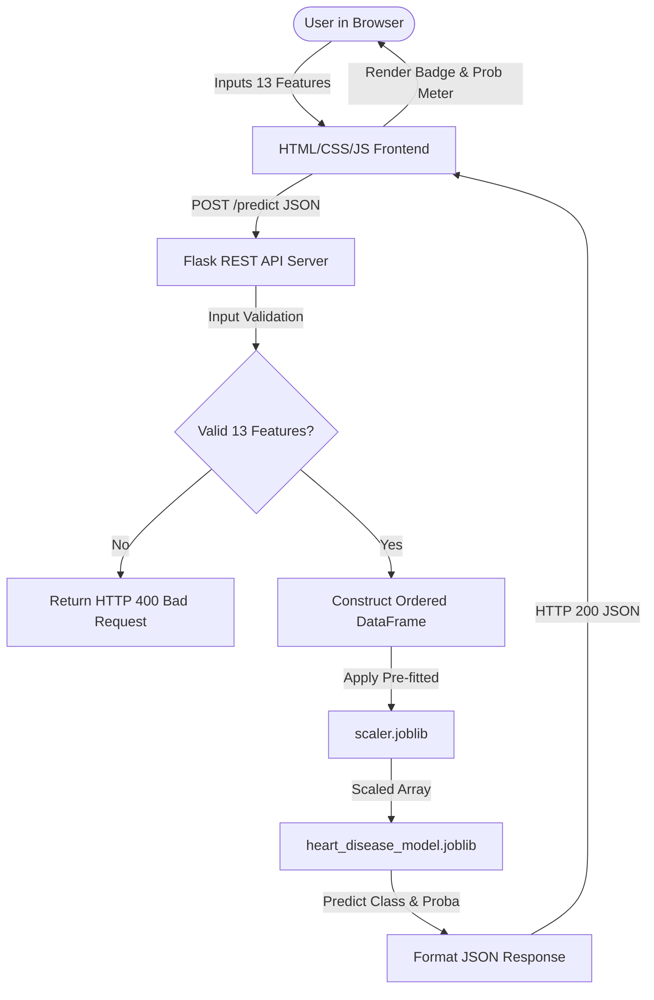

# Heart Disease Prediction System

> **Educational Machine Learning Demonstration**  
> An end-to-end Machine Learning web application utilizing patient clinical parameters and a trained Logistic Regression model to classify heart disease risk according to dataset labels.

---

## ⚠️ Important Disclaimer

**This project is strictly for educational and demonstration purposes only.**  
It is **not** a certified medical diagnostic system and must **not** be used for clinical diagnosis, treatment planning, or real-life medical decision-making. Predictions reflect statistical patterns within a historical research dataset, not medical diagnoses.

---

## 📌 Project Overview

Cardiovascular diseases are one of the leading causes of mortality worldwide. Early risk factor identification is a vital subject of research in clinical data science.

The **Heart Disease Prediction System** demonstrates the complete lifecycle of an applied Machine Learning solution:
1. **Data Exploration & Auditing:** Inspecting distributions, feature types, missing values, and duplicate records.
2. **Leak-Free Preprocessing:** Deduplicating Kaggle records, stratifying train/test splits, and fitting a `StandardScaler` strictly on training data.
3. **Model Selection & Benchmarking:** Training and evaluating Logistic Regression, Decision Tree, and Random Forest classifiers.
4. **Backend REST API:** Serving predictions with Flask, enforcing 13-feature schema validation, and reusing fitted scaler transformations.
5. **Interactive Web Interface:** A responsive, accessible frontend built with semantic HTML5, Vanilla CSS, and JavaScript `fetch()` communication.

---

## ✨ Features

- **13 Standardized Clinical Features:** Captures critical cardiovascular parameters including blood pressure, serum cholesterol, resting ECG, and fluoroscopy vessel counts.
- **Kaggle Heart Disease Dataset:** Grounded on the widely recognized UCI Machine Learning Repository heart disease dataset.
- **Rigorous Data Preprocessing:** Removes duplicate records to prevent data contamination and splits the dataset (80% train / 20% test) with stratified sampling.
- **Leak-Free Feature Scaling:** Reuses a saved `StandardScaler` fitted only on training data to normalize inference inputs.
- **Multi-Model Comparison:** Evaluates Logistic Regression, Decision Tree Classifier, and Random Forest Classifier across Accuracy, Precision, Recall, and F1-Score.
- **Production-Ready Flask Backend:** Robust input validation, exception handling, and CORS configuration.
- **RESTful API Endpoint (`POST /predict`):** Returns predictions (`0` or `1`), calibrated probability scores, and educational disclaimers.
- **Modern Responsive Frontend:** Card-based UI built with Vanilla CSS (no heavy external CSS frameworks), featuring glassmorphic accents, responsive grid layouts, and color-coded results.
- **Quick Preset Controls:** One-click sample loaders (`Load Positive Sample`, `Load Negative Sample`, `Clear Form`) for effortless testing without manual entry.
- **Real-Time Client Validation:** Gracefully handles empty, missing, or invalid values without crashing the server.

---

## 📊 Dataset Description

- **Source:** Kaggle / UCI Machine Learning Repository
- **File Location:** `dataset/heart.csv`
- **Total Records:** 1,025 rows (containing replicated records from the original 303 UCI patient cohort)
- **Unique Records After Deduplication:** 302 patients (241 training samples, 61 test samples)
- **Total Columns:** 14 (13 input features + 1 target variable)

### Feature Dictionary

| # | Feature Name | Description | Data Type | Permissible / Observed Range |
|---|---|---|---|---|
| 1 | `age` | Age of the patient in years | Numeric | 29 – 77 |
| 2 | `sex` | Biological sex | Categorical | `0` = Female, `1` = Male |
| 3 | `cp` | Chest Pain Type | Categorical | `0` = Typical Angina, `1` = Atypical Angina, `2` = Non-anginal Pain, `3` = Asymptomatic |
| 4 | `trestbps` | Resting blood pressure (in mm Hg upon admission) | Numeric | 94 – 200 mm Hg |
| 5 | `chol` | Serum cholesterol level in mg/dl | Numeric | 126 – 564 mg/dl |
| 6 | `fbs` | Fasting blood sugar > 120 mg/dl | Categorical | `0` = False (≤ 120), `1` = True (> 120) |
| 7 | `restecg` | Resting electrocardiographic results | Categorical | `0` = Normal, `1` = ST-T Wave Abnormality, `2` = Left Ventricular Hypertrophy |
| 8 | `thalach` | Maximum heart rate achieved during exercise | Numeric | 71 – 202 bpm |
| 9 | `exang` | Exercise-induced angina | Categorical | `0` = No, `1` = Yes |
| 10 | `oldpeak` | ST depression induced by exercise relative to rest | Numeric (Float) | 0.0 – 6.2 |
| 11 | `slope` | Slope of peak exercise ST segment | Categorical | `0` = Upsloping, `1` = Flat, `2` = Downsloping |
| 12 | `ca` | Number of major vessels colored by fluoroscopy | Categorical | `0`, `1`, `2`, `3` |
| 13 | `thal` | Thalassemia blood condition outcome | Categorical | `1` = Normal, `2` = Fixed Defect, `3` = Reversible Defect |
| 14 | `target` | Dataset label (Presence of heart disease) | Target | `0` = Absence / Low Risk, `1` = Presence / High Risk |

---

## 🧠 Machine Learning Pipeline

### 1. Data Cleaning & Stratification
- Deduplication prevents training and testing samples from sharing identical patient rows.
- Stratified sampling preserves the balanced 54% positive / 46% negative class distribution across train and test splits.
- `StandardScaler` calculates mean ($\mu$) and standard deviation ($\sigma$) strictly on `X_train` and transforms both `X_train` and `X_test`.

### 2. Model Evaluation & Comparison
Three candidate algorithms were trained on the 241-patient training split and evaluated against the held-out 61-patient test split:

| Model | Accuracy | Precision | Recall | F1-Score | Status |
|---|---|---|---|---|---|
| **Logistic Regression** | **80.33%** | **80.00%** | **84.85%** | **82.35%** | **Selected Model** |
| **Decision Tree** | 80.33% | 81.82% | 81.82% | 81.82% | Evaluated |
| **Random Forest (100 Trees)** | 75.41% | 76.47% | 78.79% | 77.61% | Evaluated |

### Why Logistic Regression Was Selected
1. **Highest Recall (84.85%) & F1-Score (82.35%):** In medical and risk-prediction scenarios, minimizing false negatives (missing actual cases) is critical. Logistic Regression correctly identified 28 of the 33 actual positive cases in the test set.
2. **Calibrated Probabilities:** Logistic Regression produces well-calibrated sigmoid probability scores suitable for confidence reporting.
3. **Simplicity and Generalization:** Less prone to overfitting on small clinical sample sizes than unpruned tree ensembles.

---

## 🏛️ System Architecture



---

## 📁 Project Directory Structure

```text
Heart-Disease-Prediction/
│
├── dataset/
│   ├── heart.csv                       # Original Kaggle dataset (1025 records)
│   ├── X_train.csv                     # Processed unscaled training features
│   ├── X_test.csv                      # Processed unscaled testing features
│   ├── y_train.csv                     # Training labels
│   └── y_test.csv                      # Testing labels
│
├── model/
│   ├── heart_disease_model.joblib      # Trained Logistic Regression model
│   ├── scaler.joblib                   # Pre-fitted StandardScaler instance
│   ├── model_metadata.json             # Feature names, metrics, and disclaimer
│   └── evaluation/                     # Generated visual evaluation plots
│       ├── confusion_matrix_all_models.png
│       ├── confusion_matrix_logistic_regression.png
│       ├── confusion_matrix_decision_tree.png
│       └── confusion_matrix_random_forest.png
│
├── static/
│   ├── css/
│   │   └── style.css                   # Custom responsive styling
│   └── js/
│       └── script.js                   # Form controller, async fetch(), DOM updates
│
├── templates/
│   └── index.html                      # Semantic frontend layout
│
├── app.py                              # Flask application & REST endpoints
├── inspect_dataset.py                  # Dataset inspection & summary statistics
├── preprocess_data.py                  # Data cleaning, deduplication, splitting, scaling
├── train_model.py                      # Model training, comparison & persistence
├── requirements.txt                    # Project dependencies
└── README.md                           # Documentation
```

---

## 🚀 Getting Started Locally

### Prerequisites
- Python 3.9 or higher installed
- Git installed (optional)

### 1. Clone or Open the Project Directory
```bash
git clone https://github.com/your-username/Heart-Disease-Prediction.git
cd Heart-Disease-Prediction
```

### 2. Set Up a Virtual Environment
```bash
# On Windows
python -m venv venv
venv\Scripts\activate

# On macOS/Linux
python3 -m venv venv
source venv/bin/activate
```

### 3. Install Dependencies
```bash
pip install -r requirements.txt
```

### 4. (Optional) Run Preprocessing and Model Training
The repository comes with the pre-trained model and fitted scaler saved in `model/`. To inspect or regenerate them:
```bash
# Clean data, deduplicate, and split
python preprocess_data.py

# Train models and generate evaluation metrics & confusion matrices
python train_model.py
```

### 5. Launch the Web Application
```bash
python app.py
```

Open your browser and navigate to:
```text
http://127.0.0.1:5000/
```

---

## 📡 API Reference

### 1. Root Health Check & UI
- **URL:** `/`
- **Method:** `GET`
- **Description:** Renders the interactive frontend application (`templates/index.html`).

---

### 2. Predict Heart Disease Risk
- **URL:** `/predict`
- **Method:** `POST`
- **Header:** `Content-Type: application/json`

#### Request Body Example
```json
{
  "age": 58,
  "sex": 0,
  "cp": 0,
  "trestbps": 100,
  "chol": 248,
  "fbs": 0,
  "restecg": 0,
  "thalach": 122,
  "exang": 0,
  "oldpeak": 1.0,
  "slope": 1,
  "ca": 0,
  "thal": 2
}
```

#### Successful Response (`prediction = 1`)
```json
{
  "success": true,
  "prediction": 1,
  "result": "Heart disease prediction: Positive",
  "probability": 0.6947,
  "disclaimer": "Educational prediction only. Not a medical diagnosis."
}
```

#### Successful Response (`prediction = 0`)
```json
{
  "success": true,
  "prediction": 0,
  "result": "Heart disease prediction: Negative (No heart disease indicated according to dataset label)",
  "probability": 0.7511,
  "disclaimer": "Educational prediction only. Not a medical diagnosis."
}
```

#### Error Response Example (`HTTP 400 Bad Request`)
```json
{
  "success": false,
  "error": "Missing required field(s): thal"
}
```

---

## 🧪 Verification & Testing

The system has been verified using multi-scenario testing:
- **Positive Test:** Verified using ground-truth positive patient records (`prediction: 1`, `probability: 0.6947`).
- **Negative Test:** Verified using ground-truth negative patient records (`prediction: 0`, `probability: 0.7511`).
- **Validation Failure:** Verified rejection of incomplete, null, and non-numeric inputs with clear `HTTP 400` messages.
- **Cross-Platform Responsiveness:** Layout validated on desktop, tablet, and mobile viewport breakpoints.

---

## 📚 Educational Value & Key Takeaways

1. **Preventing Data Leakage:** Always fit your transformers (`StandardScaler`) exclusively on training data before applying them to test data or new inference inputs.
2. **Feature Ordering in ML:** Machine Learning models do not track dictionary keys; column arrays must be strictly ordered to match the training matrix.
3. **Evaluating Healthcare Metrics:** Accuracy alone can be misleading. Prioritizing **Recall** and **F1-Score** ensures models are optimized against dangerous false negatives.
4. **Responsible AI Communication:** Predictive models in healthcare demonstrations must always state educational limitations clearly and explicitly avoid presenting outputs as diagnostic confirmations.

---

## 📄 License
This project is open-source under the [MIT License](LICENSE).
